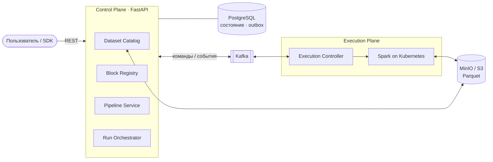

# E3 Data Platform

[](https://github.com/trudogolik45/e3-data-platform/actions/workflows/ci.yml)
[](https://github.com/trudogolik45/e3-data-platform/actions/workflows/e2e.yml)

Платформа обработки данных: пользователь загружает датасет, собирает из готовых блоков граф обработки (DAG), запускает его на Spark и получает новую версию датасета в Data Lake.

Архитектура рассчитана на рост до ML/AI-платформы, но ML-инфраструктуру не внедряем раньше времени.

## Как это работает



- **Control Plane** — модульный монолит на FastAPI. Хранит датасеты, блоки, пайплайны и запуски. PostgreSQL — источник истины.
- **Execution Plane** — развёртывается отдельно. Execution Controller запускает Spark-задания в Kubernetes и следит за ними.
- **Kafka** передаёт между плоскостями только команды и события. Сами данные идут через S3.
- Каждый результат — неизменяемая версия датасета. Повторный запуск и рестарт сервисов не дублируют и не теряют опубликованные данные.

Подробнее: [PRD.md](PRD.md), решения — в [docs/adr](docs/adr), термины — в [GLOSSARY.md](GLOSSARY.md).

## Что уже работает

- Загрузка CSV и версии датасетов.
- Регистрация блоков и пайплайнов, проверка DAG до запуска.
- Многоузловой DAG `Read → Filter → Aggregate → Publish Dataset` на настоящем Spark в Kubernetes.
- Ретраи с гарантией одной активной попытки на узел и восстановление после потери задания.
- CI на каждый PR и e2e-прогон на kind на каждый push в `main`.

Дальше по плану: отмена запусков, доступ по ролям (OIDC), лимиты, изоляция workload'ов, сквозная трассировка, затем Iceberg, Trino и Superset. План — в [Issues](https://github.com/trudogolik45/e3-data-platform/issues).

## Стек

Python 3.13, FastAPI, SQLAlchemy, PostgreSQL, Kafka (KRaft), MinIO / S3, Apache Spark, Kubeflow Spark Operator, Kubernetes, uv, ruff, pyright, pytest, testcontainers.

## Быстрый старт

Нужны Docker и [uv](https://docs.astral.sh/uv/).

```sh
docker compose up -d --build   # API на :8000, MinIO на :9000, Kafka на :9092
```

Документация API — http://localhost:8000/docs.

## Проверки

```sh
uv run ruff check . && uv run ruff format --check . && uv run lint-imports   # линтер
uv run pyright                                                               # типы
uv run pytest                                                                # unit и integration (нужен Docker)
scripts/block-tests.sh                                                       # Spark-блоки в образе apache/spark
scripts/e2e.sh                                                               # e2e на Spark: kind + Spark Operator
```

## Лицензия

© 2026 trudogolik45. Все права защищены. Код открыт только для просмотра — см. [LICENSE](LICENSE).
